<h1 align="center">Hi there, I'm Riccardo 🖖</h1>

  

  
  
  

  

### 🙋‍♂️ About me

Senior Software Developer @ **Optimizely CMS**, Berlin 🇩🇪 · from Italy 🇮🇹  
**Frontend** lover for 15+ years, handcrafting the web, caring about **performance** and **accessibility**.  
This is my personal playground for side projects and experiments; my day-to-day work lives on [@ptz000](https://github.com/ptz000).  
Off-screen: wild nature 🌲, music discovery 🎧, slow veg food 🍕

### 🛠️ Tech Stack

  
   
  
   
  

### 📊 Stats

  

  

### 🔥 Streak

  

### 🏆 Trophies

  

### 🐍 Contributions

  <picture>
    <source media="(prefers-color-scheme: dark)" srcset="https://raw.githubusercontent.com/petraplatz/petraplatz/output/github-snake-dark.svg" />
    <source media="(prefers-color-scheme: light)" srcset="https://raw.githubusercontent.com/petraplatz/petraplatz/output/github-snake.svg" />
    
  </picture>

  

  

